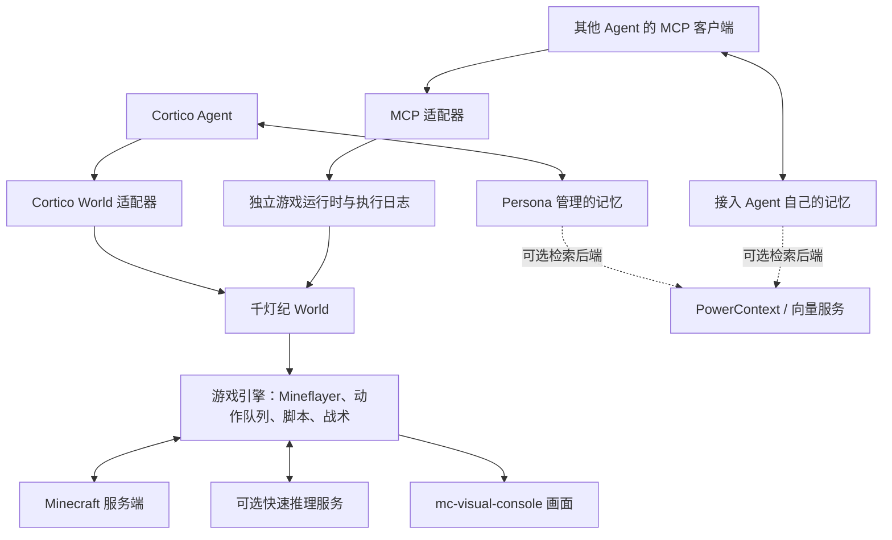

<!-- Owner: src/adapters/cortico.ts, src/agent/runtime.ts, src/agent/journal.ts, src/mcp/server.ts, scripts/build-release.ts, scripts/build-host-runtime.ts -->

# 架构与接入边界

项目定义为“面向 Minecraft 的具身 Agent Harness”，覆盖环境执行、方法制品与反馈、现代化/OBS 画面及技术分析。完整能力表和独立指标接入见 [Harness 定义与接线](harness.md)。主决策与记忆仍由 Agent 宿主提供。

同一套 Minecraft 工具、游戏执行器和回执可以通过 Cortico World 或独立 MCP 入口使用。独立入口不启动 Cortico Core、Persona、主播演出或记忆系统。

图中的两种宿主各自创建游戏实例。每个实例使用自己的账号、数据目录和画面端口。

| 能力 | 归属及实现位置 | 对外边界 |
| --- | --- | --- |
| 通用会话、事件调度、模型调用、工具派发 | Cortico `src/core/` | WorldHost 与工具/事件契约 |
| 长期目标、上下文整理、反思、注意力、记忆读写 | Cortico `bots/cormini/persona/`、`bots/cortiv/persona/` | Persona 选择记忆实现；其他 Agent 使用自己的实现 |
| 本地事实版本、待办、日程、方法库 | Persona 的 `state-memory.ts`、`pending-work.ts`、`activity-agenda.ts`、`procedures.ts` | 记忆由 Agent 解释，世界实际状态由游戏观察提供 |
| 向量与外部记忆服务 | 独立服务；可由 Persona/其他 Agent 的记忆适配器访问 | 当前插件未接入 PowerContext，不安装向量数据库；局域网实例能力尚待核验 |
| 游戏连接、登录、背包、挖掘、放置、路线、技能 | 本仓库 `src/world.ts` 与生成的 `engine/` | 共享的 `mymc_*` 工具和事件 |
| 快战术现场采样、候选、控制权、短步与施法 | `engine/combat.ts`、`combat-program.ts`、`combat-decision.ts` | `mymc_combat_tactic`；推理端点由 `combatDecision` 配置 |
| 快推理模型服务 | 独立 HTTP 服务 | 游戏引擎直接发送现场信息并复核返回结果；不等待主 Agent 整理战场 |
| 快速注意力、资料选择、上下文与思考建议 | Cortico Persona 的 `attention-adviser.ts`、`reference-adviser.ts`、`foreground-adviser.ts` | 与游戏快战术分别持有配置、上下文和职责，可调用同一外部推理服务 |
| 通用方法的作者、版本、评价与采用 | Agent 的方法库；Cortico 实现在 Persona `procedures.ts` | 传入明确选择的、带版本与哈希的方法制品 |
| 方法的游戏执行、原生接口、真实调用轨迹 | `engine/method-runner.ts`、`method-worker.mjs`、`method-mineflayer.ts` | `mymc_script`；校验、执行、目标达成分别记录 |
| 网页渲染 | 独立仓库 `jcs130/mc-visual-console` | 本包固定版本的画面产物与游戏读数 |
| 技术分析与 OBS 指标 | 共享仓库 `tools/model-status-overlay`；本包 `src/agent/metrics.ts` | 元数据契约与只读 HTTP/MCP；工具返回由运行时测，模型与方法由宿主上报 |
| 演出、TTS、唱歌 | 独立 VTuber 扩展 | 由宿主另行装配 |

## 游戏层与宿主适配

- `src/adapters/cortico.ts`：Cortico API 5 的装配入口。`src/index.ts`、`src/definition.ts` 保留原有导出。
- `src/agent/runtime.ts`：独立生命周期、游戏工具调用、可选模型能力与后台认知端口。接入方可直接使用，或通过 MCP 调用。
- `src/agent/journal.ts`：执行日志、事件游标、附件句柄。它保存观察与执行数据，不创建记忆结论，也不判断目标成功。
- `src/mcp/server.ts`：现有工具 JSON Schema 与回执的协议转换；不重新实现游戏动作或战术。

脚本和战术使用同一个游戏引擎，保留已有控制权、碰撞、落脚、资源和执行预算检查。快速战术服务可选；未配置服务时，不声称已执行快速模型选择。

MCP 适配器将工具直接返回的外部事件正文附在结果中。长期动作在受理后继续执行，接入方需要读取后续事件与实际状态。取消一次 MCP 请求不等于取消已经受理的游戏任务；任务停止使用游戏工具已有的队列与取消契约。

## 记忆与编排

World 提供现场信息、可编辑脚本/战术入口和带证据的执行回执。Agent 决定学习目标、编写方法、解释反例、保留或采用版本。Cortico Persona 的方法库可管理这些版本；其他 Agent 可以使用自己的库。

`mymc_artifact` 仅保存明确提交的 UTF-8 执行制品，并返回内容寻址句柄。复合方法沿用 `cortico.procedure/v1` 数据格式，解析与执行不要求运行 Cortico。直接源码执行仍使用 `mymc_script`。方法保存、执行结束、评价为成功和跨场景改善是不同状态。

PowerContext 可承担记忆检索或经验检索后端。它不代替游戏当前血量、位置、碰撞与技能读数，也不直接拥有游戏操作控制权。服务地址、权限、命名空间、版本与检索能力需要在记忆适配层核验；当前改动未迁移现有记忆。

## 构建依赖

游戏引擎仍由 `release-sources.json` 指定的 Cortico Minecraft 源码与本仓库补丁生成。构建期使用固定提交；执行期不需要安装 Cortico 或启动它的主循环。

`scripts/build-host-runtime.ts` 从同一固定提交打包时间、模板、日志工具；它们随游戏包发布。子进程加载器在本包解析，不依赖调用 Agent 的目录或 Cortico 的解析钩子。Cortico 类型是开发期依赖，浏览器控制台仍通过原有 Cortico 扩展接口装配。

发布校验检查这些运行时工具的哈希。MCP 的进程测试拒绝全部 `cortico` 运行时导入，再通过官方客户端执行工具发现与读取。正式服登录、移动、命中等实际结果需要单独验证。
