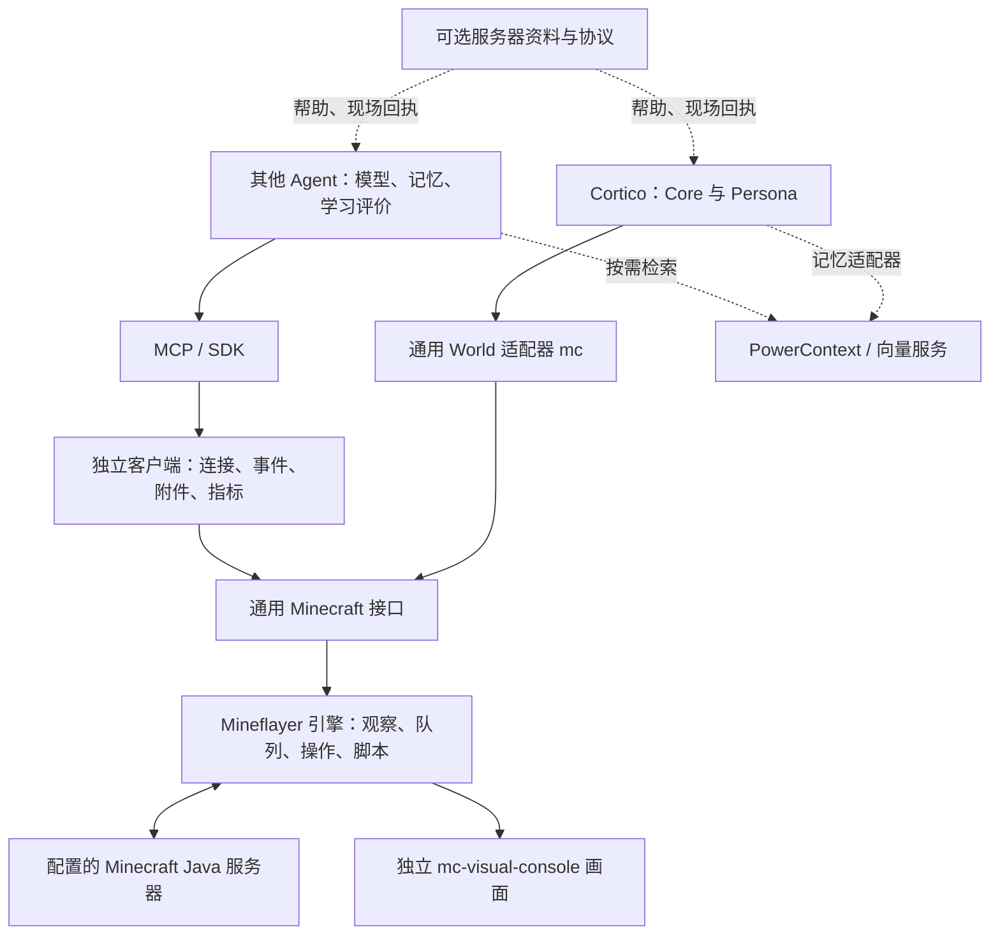

# 架构边界

产品名 **Agent MC World**；执行产品是 Mineflayer 客户端 / 具身 Agent Harness，skill 是配套使用说明，Cortico World 是一个宿主适配器。默认发行包不包含千灯纪玩法适配层。

每个 Agent 自己装配一个实例。两种宿主不共享正式服账号或身体控制权。

| 能力 | 归属 | 代码 / 边界 |
| --- | --- | --- |
| 通用主循环、模型调度、系统 2 | 接入的 Agent；Cortico 时是 Core/Persona | 不在客户端启动另一套主模型 |
| 目标、长期记忆、假设、方法评价与检索 | Agent / Persona | PowerContext 与向量服务是可选后端；本次未接入或迁移记忆 |
| 结构契约、生命周期、日志、附件、指标 | 本项目客户端 | `src/client/`，自有类型；不导入 Cortico 或服务器玩法 |
| MCP | 本项目协议适配器 | `src/mcp/server.ts`、`stdio.ts`；只转换现有操作/回执 |
| Cortico World | 本项目宿主适配器 | `src/adapters/minecraft.ts`；ID `mc`、配置 `worlds.mc.*` |
| 游戏连接、动作执行、原生脚本与组合方法 | 本项目自有核心 | `core/`；共用 Mineflayer、队列、身体租约及取消语义 |
| 通用反射、随机小动作 | 游戏核心 | 直接现场采样；模型建议和选择由宿主负责 |
| RPG 战术执行 / 法术协议 | 可选千灯纪集成 | 模型选择在宿主；扩展复核现场并执行，核心无服务器协议 |
| 千灯纪账号、传送、公会/试炼与技能目录 | 可选服务器集成 | `integrations/qiandengji/`；不在通用包的文件列表中 |
| 现代网页与 OBS 游戏层 | 独立共享仓库 | `jcs130/mc-visual-console`；本包固定提交产物，无千灯纪素材预设 |
| LLM 技术统计 | 宿主插桩 + 本项目指标适配 + 共享观察页面 | `src/client/metrics.ts`、MCP `mc_trace`；未知字段保持未知 |
| 演出、TTS、唱歌 | 独立 VTuber 扩展 | 分别配置和发布 |

## 自主学习与编排

Agent 通过 `mc_help`、`mc_script {"api":"index"}` 获取实际可用的原生接口，按需读取主题；从服务端帮助和现场反馈发现服务器技能。底层不替 Agent 选择一条固定玩法，也不把某服务器命令自动当成每个服务器的能力。

Agent 可编写脚本，或使用带版本/哈希的 `agent-mc.procedure/v1` 方法制品（兼容旧 `cortico.procedure/v1`）。该格式名是兼容的序列化标识，执行不需要 Cortico。方法组合和原生脚本共用执行层，避免另造一套导航、挖放或控制器。

执行日志是事实证据，不是亲历记忆结论。完整学习链应包括作者、假设、源码与父版本、校验、展开执行终态、世界净变化、采用/回退及相似场景复用。检索、评价与采用由宿主提供；客户端不冒称模型权重进化。

## 构建与剩余边界

核心在 `core/` 独立维护；一次性迁入的来源、许可证和补丁哈希在 `provenance/`，构建不再读取框架。`release-sources.json` 固定并校验共享画面制品。默认包导出 SDK，宿主和服务器扩展通过中立端口依赖核心。完整迁移对照见 [框架解耦](framework-decoupling.md)。

通用 MCP 测试禁止加载 Cortico 和服务器玩法模块；SDK 消费检查禁止解析 Cortico 类型。旧 `src/world.ts` 等文件是工作区兼容转发，保留现役可米的加载路径，不随通用包分发。源代码提交、安装包、部署加载和实际游戏验证分别记录。
